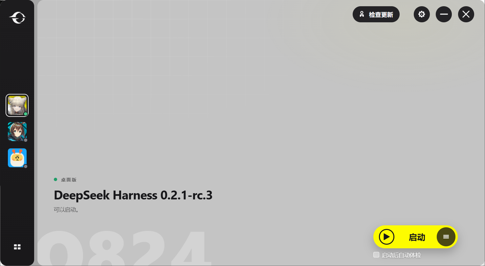

# P4 扩展：启动器窗口（发行版板）

> 设计说明见 [`docs/superpowers/specs/2026-11-05-p4-gui-board-design.md`](superpowers/specs/2026-11-05-p4-gui-board-design.md)。



版面不是估的，是拿第一张参考图量的：窗口内容 1583×869，按 1180 宽等比得到 **1180×648**；
左栏 82（参考 110）、两块面板贴住窗口四边、中间 8px 灰缝（参考 10）、面板圆角 15（参考
20）；右上圆钮 39（参考 52）、上距 15、右距 26；主按钮 205×56（参考 275×75）、右距 66，
**菜单圆钮在胶囊内部**（参考图就是这样，不是胶囊外面再加一个圆）；播放圈 38、文字 20；
复选框 14、标签 13.5。逐项对照见设计文档 §4。

图标也按参考图重画了：人形登录位、实心 8 齿齿轮、3px 粗横线/2.6px 粗 X、主按钮 22px 圆角
实心三角 + 20px 粗汉堡、左下 2×2 圆角方块 20×17（之前的 19×13 太扁）。细节见设计文档 §4。

## 现在能看到的

| 界面 | 证据 | 结论 |
|---|---|---|
| 主界面（三个发行版、选中、状态点、版本、内核句子） | `images/p4-gui-board.png` | 桌面版被选中并诊断，web/tui 角标为"未检查"的灰点 |
| 切到 web 发行版 | `O824_GUI_QUERY=kind=web` 截图 | 选中第二个槽位，版本 0.2.1-rc.5，角标变绿，桌面版退回灰点 |
| 空机器（三个槽位都没有） | `O824_GUI_EMPTY=1` 截图 | 三个图变灰，主按钮变成"安装 DeepSeek Harness" |
| 有问题（f01 树） | `O824_ROOT=…/f01/app O824_HOME=…/f01/home` 截图 | 橙点、标题变"起不来"、按钮变"一键修复"（扳手图标） |
| 详情（发现问题） | 同上 + `O824_GUI_DETAILS=1` | 黄色左边条卡片、原因、下一步、复制/关闭/一键修复 |
| 详情（没有问题） | 正常机器 + `O824_GUI_DETAILS=1` | 绿色对勾 + "没有发现问题。" |
| ≡ 菜单 | `images/p4-gui-menu.png` | 四项与参考图对应，最后一项有分隔线，按钮变 × |
| 设置 | `images/p4-gui-settings.png` | 左导航 + 三组开关，浅色勾选框，背景模糊 |
| 关于 | `O824_GUI_ABOUT=1` 截图 | logo、版本、非官方/未签名/开源、仓库地址、四个动作 |
| 安装引导 | `O824_GUI_GUIDE=1` 截图 | 三条官方方式、命令、复制按钮 |
| 未签名说明 | `O824_GUI_TRUST=1` 截图 | 原有 `trust_help` 文案原样进入弹层 |
| 关窗说明 | `?close=1` 截图 | "仍在后台运行" + 不再提示 + 留在后台/退出 |
| 更新弹层 | `O824_GUI_UPDATE=1` 截图 | 检查中/失败两种状态；本机因 `%LOCALAPPDATA%` 不可写停在失败态 |

截图脚本：`scripts/gui-shot.ps1`（DPI 感知、topmost、取 DWM 可见边界、拒绝拍旧窗口）。

## 机器上跑过什么

- `cargo test --workspace`：全绿（含 `o824-present` 新增的 chrome 文案测试）。
- GUI release 构建：

  ```bash
  source scripts/env.sh
  source scripts/env-msvc.sh
  cd apps/o824-gui
  cargo +stable-x86_64-pc-windows-msvc build --release
  ```

- 真机 `list` 287–650 ms、`diagnose` 桌面版 3.6–4.4 s（与 P3 相同，窗口先出列表不再重要，
  但现在主区先显示"正在检查…"）。
- 语言：中文 Windows 下界面为中文（`GetUserDefaultUILanguage`），`O824_LOCALE=en-US`
  可强制英文（未截图，文案测试覆盖两种语言）。

## 还没验证的

1. **修复应用**：实验室 f01/f02/f16 在当前内核上的 `repair --dry-run` 都是 0 步
   （Go oracle 同样 0 步），所以"确认 → apply"没有在 GUI 里端到端跑过；弹层与确认逻辑
   沿用 P3，未改协议。用一棵真坏树或修好的 fixture 再跑一次即可。
2. **更新成功态**：`%LOCALAPPDATA%\o824\staged` 在这台机器上不可写（os error 5），
   GitHub 也不可达；只验证了"检查中/失败"两种弹层。功能是 P4 原来的 `update --fetch`，
   没有改动。
3. **开机自动启动 / 创建桌面快捷方式**：会改系统状态（HKCU Run、桌面 .lnk），没有在
   用户睡觉时按下去。代码路径已编译，失败会回滚开关并 toast。
4. **最小化 / 关闭到托盘 / 托盘恢复**：没有用合成鼠标点击（本机 2026-11-04 误点过用户
   窗口，见记忆里的教训）。Tauri 托盘在本环境注册成功（日志 `tray: created`），
   `window_action` 是三个直调。
5. **背景插图**：按用户要求留空。

## 改动的文件

```
apps/o824-gui/dist/index.html        重写（板 + 七个弹层）
apps/o824-gui/dist/style.css         重写（参考图配色/尺寸）
apps/o824-gui/dist/app.js            重写（选择、状态、弹层、tray/设置/更新）
apps/o824-gui/dist/assets/           新增 logo.png + tab-{desktop,web,tui}.png（占位）
apps/o824-gui/src/main.rs            无边框窗口、locale、chrome/absent/shell_info/window_action/
                                     set_autostart/create_shortcut/clear_cache/open_log/
                                     open_url、WebView2 数据目录修复、内核查找 6 层
apps/o824-gui/Cargo.toml             windows features（Globalization/Registry）
crates/o824-present/src/chrome.rs    新增（窗口家具的双语文案 + absent_copy）
crates/o824-present/src/lib.rs       Chrome/absent 导出、catalog 增补、Copy 可序列化
scripts/gui-shot.ps1                 新增（可靠的窗口截图）
.gitignore                           让 apps/o824-gui/dist 下的新素材能被 add
```

## 如何复现一张截图

```bash
cd o824-rs
source scripts/env.sh && source scripts/env-msvc.sh
cd apps/o824-gui && cargo +stable-x86_64-pc-windows-msvc build --release && cd ../..
powershell -File scripts/gui-shot.ps1 -Out shot.png -Wait 12
```

想看某个状态，在调用前设 `O824_GUI_QUERY='kind=web'`、`O824_GUI_SETTINGS=1`、
`O824_GUI_MENU=1`、`O824_GUI_DETAILS=1`、`O824_GUI_ABOUT=1`、`O824_GUI_UPDATE=1`、
`O824_GUI_TRUST=1`、`O824_GUI_GUIDE=1`、`O824_GUI_EMPTY=1`，或
`O824_GUI_QUERY='close=1'`。
