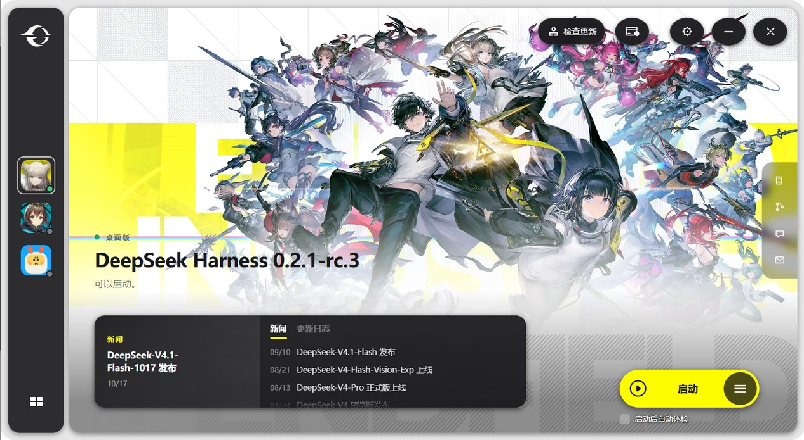

# P4 扩展：启动器窗口（发行版板）

> 设计说明见 [`docs/superpowers/specs/2026-11-05-p4-gui-board-design.md`](superpowers/specs/2026-11-05-p4-gui-board-design.md)。



窗口现在是启动器的 **CSS 视口 1266×695**（参考图 1583×869 是它 1.25 缩放下的截图），
所以所有组件都用启动器自己的 CSS 尺寸，不再等比缩放：窗口四周 12px 透明边（根容器 `p-3`）、
左栏 88、8px 灰缝、卡片圆角 18（窗口 24）、槽位 48（间距 19）、右上按钮 40（距面板上/右各 16）、
登录胶囊高 40/字号 13、主按钮 **220×60**（距面板右 60、药丸下沿距面板底 40）、播放圈 26、
文字 16、菜单圆钮 52、复选框 16（r4、无边框四态）/白字 12、左下 52×52。逐项对照见设计文档 §4。

> P0 对齐（见 `P4-GUI-GAP.md`）：顶栏改 `top 16 / right 16` + 分隔线；主按钮改用启动器四态
> 色（`#FDFC00` / hover `#FEFD4D` / pressed `#E4E300` / disabled `#A0A0A0`）；菜单改 `r8`、
> `p8`、行高 42/14px、hover 白 15%、`blur 4`；复选框 16×16 `r4`；logo 换成 `gf` 矢量（54×48）。
>
> P1 动效（同文档 §15）：左栏图标 hover `scale(1.08)` / active `.97`、选中环白 75%；汉堡由三根
> 白条旋转成 ✕（±45°/±5px，100ms）；菜单 `opacity .3s`、弹层 `scale .95→1 .2s`；字体栈改微软
> 雅黑；滚动条 4px/白 25%；右上圆钮改 content-box（41×41）、去掉背景过渡。
>
> P2 结构（同文档 §16）：窗口骨架按 web 包的 `p-3` 落地——四周 12px 透明、两块 18px 圆角卡片、
> 1px 白 10% 描边 + `0 2px 8px .45` 阴影，根容器 24px 圆角只作用于遮罩；左栏可拖拽排序并持久化
> （8px 起拖、落位 `sorting-shake`）；切发行版时主文案播 300ms 入场。

图标也不是重画的：右上四个是启动器 web UI 的 SVG 组件（`xf` 人形 24、`Ef` 齿轮 16、`vf`
横线 14、`of` 四段 X 24），菜单三横是 Qt 资源 `svg_57`（18×12）。左下四格是启动器的 CSS
画法（52×52 按钮、14×14 框里四个 6×6 白方块、空闲 `scaleX(1.4)`、打开时 45°）；播放是
`Of`（26×26：24px 圆环 + 三角）。全部按原始尺寸。细节见设计文档 §4。

## 美术资源：从鹰角启动器里取的

参考图就是这台机器上的 **Hypergryph Launcher 1.6.0**（Qt 5 + WebEngine，UI 在
`res/web`）。它的美术资源不在 `res/web/assets`（那里只有一张 405×100 的 `pattern3`
点阵），而是三处：

| 资源 | 位置 | 用法 |
|---|---|---|
| Endfield 主视觉（2324×1392，带 ENDFIELD 水印、网格、黄块） | `Games.exe` 内嵌的 Qt 资源，扫 `RIFF....WEBP` 得到；offset `12284516`，303 KB | `dist/assets/background.webp`，主区 `center/cover` |
| 三个游戏图标（256×256） | `res/icons/endfield.ico`、`arknights.ico`、`popucom.ico` | `dist/assets/tab-{desktop,web,tui}.png` |
| 鹰角标志（白 mark） | web UI 的 SVG 组件 `gf`（54×48，两条白 path） | `dist/assets/logo.svg`，矢量 |

`Games.exe` 里还有：同一张 Endfield 的无水印版（`12588022`，394 KB）、两张 3.2/2.9 MB 的
Arknights 主视觉、Popucom 的 334 KB 主视觉，以及 10 张 474×474 的游戏封面。提取脚本的
做法就是扫 `RIFF`+`WEBP`、`\x89PNG`、`\xff\xd8\xff`，按容器长度切出来；Qt 资源没有
`qres` 头（它是编译进二进制的 C++ 数组），所以按文件签名扫比找 RCC 树更省事。

> **版权**：这些是鹰角网络的美术资源，从本机安装的启动器里取出来只为对齐界面，**不要**
> 随仓库分发。发布版应换成自有素材，或把 `dist/assets/background.webp` 与三个
> `tab-*.png` 从发布包里去掉（窗口会回落到灰色占位，代码里保留了 `--stage` 兜底色）。

## 现在能看到的

| 界面 | 证据 | 结论 |
|---|---|---|
| 主界面（三个发行版、选中、状态点、版本、内核句子） | `images/p4-gui-board.jpg` | 桌面版被选中并诊断，web/tui 角标为"未检查"的灰点 |
| 切到 web 发行版 | `O824_GUI_QUERY=kind=web` 截图 | 选中第二个槽位，版本 0.2.1-rc.5，角标变绿，桌面版退回灰点 |
| 空机器（三个槽位都没有） | `O824_GUI_EMPTY=1` 截图 | 三个图变灰，主按钮变成"安装 DeepSeek Harness" |
| 有问题（f01 树） | `O824_ROOT=…/f01/app O824_HOME=…/f01/home` 截图 | 橙点、标题变"起不来"、按钮变"一键修复"（扳手图标） |
| 详情（发现问题） | 同上 + `O824_GUI_DETAILS=1` | 黄色左边条卡片、原因、下一步、复制/关闭/一键修复 |
| 详情（没有问题） | 正常机器 + `O824_GUI_DETAILS=1` | 绿色对勾 + "没有发现问题。" |
| ≡ 菜单 | `images/p4-gui-menu.jpg` | 四项与参考图对应，最后一项有分隔线，按钮变 × |
| 设置 | `images/p4-gui-settings.jpg` | 左导航 + 三组开关，浅色勾选框，背景模糊 |
| 关于 | `O824_GUI_ABOUT=1` 截图 | logo、版本、非官方/未签名/开源、仓库地址、四个动作 |
| 安装引导 | `O824_GUI_GUIDE=1` 截图 | 三条官方方式、命令、复制按钮 |
| 未签名说明 | `O824_GUI_TRUST=1` 截图 | 原有 `trust_help` 文案原样进入弹层 |
| 关窗说明 | `?close=1` 截图 | "仍在后台运行" + 不再提示 + 留在后台/退出 |
| 更新弹层 | `O824_GUI_UPDATE=1` 截图 | 检查中/失败两种状态；本机因 `%LOCALAPPDATA%` 不可写停在失败态 |
| 公告栏（新闻 / 更新日志两个 tab） | `images/p4-gui-board.jpg`、`O824_GUI_QUERY=notice=updates` 截图 | 内容来自 `api-docs.deepseek.com` 的新闻页与更新日志，24 条，卡片 680×146 |
| 充值中心 | 右上第二颗圆钮 | 打开 `platform.deepseek.com/top_up` |
| 社区栏 | 右侧 56px 竖条 | 文档 / 仓库 / 社区 / 邮箱四个入口，链接在 `app.js` 的 `COMMUNITY` 数组里 |

截图脚本：`scripts/gui-shot.ps1`（DPI 感知、topmost、取 DWM 可见边界、拒绝拍旧窗口）。

## 充值中心、社区栏、公告栏（2026-11-05）

启动器主界面上还有三块我们没有的家具，这次一起补上：

| 面 | 启动器 | 我们 |
|---|---|---|
| 充值中心 | 右上左组第二颗圆钮（`If` 钱包图标 24px），跳 `payment_url` | 同位置同图标，跳 `https://platform.deepseek.com/top_up` |
| 社区栏 | 右侧 56px 竖条：`w-[56px] py-[12px] gap-[10px] rounded-l-[16px] bg-black/30 blur(6px)`，30px 圆钮 hover 白 25% | 同几何；四个入口由 `app.js` 的 `COMMUNITY` 数组生成（文档 / 仓库 / 社区 / 邮箱），换链接只改这一处 |
| 公告栏 | 左下 146px 卡片：260px 横幅 + 420px 列表，圆角 16，`0 2px 8px .65` | 同尺寸；左侧是当前 tab 最新一条的标题卡，右侧是两 tab 列表（新闻 / 更新日志），点行打开原页 |

**数据从哪来**：`api-docs.deepseek.com` 不发 CORS 头，WebView 里 `fetch()` 会被拦掉，所以抓取放在 Rust 侧（`apps/o824-gui/src/news.rs` + `news` 命令）：

- 新闻：抓 `/zh-cn/news/news261017` 的 HTML，从侧边栏 `menu__link` 取标题与日期（同一 href 出现两次时去重）；
- 更新日志：抓 `/zh-cn/updates.md`（Markdown，比渲染后的 HTML 好解析），按 `## 时间: …` / `### …` 配对；
- 结果写 `o824-news.json`（`%LOCALAPPDATA%\O824` → exe 目录 → `%TEMP%`，逐个探测可写），TTL 30 分钟；本机实测首次 306ms、命中缓存 0ms；
- 取不到就退回缓存并标 `stale`，全空时整块隐藏，不会出现空壳。

**为什么加依赖**：`ureq`（rustls）是这棵依赖树里第一个 HTTP 客户端；不引它就只能自己写 WinHTTP 的 FFI，或者把内容硬编码进包里。二进制 9.6MB → 约 10MB。

**位置代价**：公告卡片占了左下 146px，主文案（桌面版 / 标题 / 可以启动）从 `bottom:120` 提到 `bottom:200`，左边缘 44 → 40，与卡片左边线对齐。

`cargo test` 里有 5 个解析用例（Markdown 配对、无日期标题跳过、侧边栏去重、链接文本没日期时忽略、日期形状检查）。

## 机器上跑过什么

- `cargo test --workspace`：全绿（含 `o824-present` 新增的 chrome 文案测试）。
- GUI release 构建：

  ```bash
  source scripts/env.sh
  source scripts/env-msvc.sh
  cd apps/o824-gui
  cargo +stable-x86_64-pc-windows-msvc build --release
  ```

- 真机 `list` 287–650 ms、`diagnose` 桌面版 3.6–4.4 s（与 P3 相同，窗口先出列表不再重要，
  但现在主区先显示"正在检查…"）。
- 语言：中文 Windows 下界面为中文（`GetUserDefaultUILanguage`），`O824_LOCALE=en-US`
  可强制英文（未截图，文案测试覆盖两种语言）。

## 还没验证的

1. **修复应用**：实验室 f01/f02/f16 在当前内核上的 `repair --dry-run` 都是 0 步
   （Go oracle 同样 0 步），所以"确认 → apply"没有在 GUI 里端到端跑过；弹层与确认逻辑
   沿用 P3，未改协议。用一棵真坏树或修好的 fixture 再跑一次即可。
2. **更新成功态**：`%LOCALAPPDATA%\o824\staged` 在这台机器上不可写（os error 5），
   GitHub 也不可达；只验证了"检查中/失败"两种弹层。功能是 P4 原来的 `update --fetch`，
   没有改动。
3. **开机自动启动 / 创建桌面快捷方式**：会改系统状态（HKCU Run、桌面 .lnk），没有在
   用户睡觉时按下去。代码路径已编译，失败会回滚开关并 toast。
4. **最小化 / 关闭到托盘 / 托盘恢复**：没有用合成鼠标点击（本机 2026-11-04 误点过用户
   窗口，见记忆里的教训）。Tauri 托盘在本环境注册成功（日志 `tray: created`），
   `window_action` 是三个直调。
5. **背景插图**：按用户要求留空。

## 改动的文件

```
apps/o824-gui/dist/index.html        重写（板 + 七个弹层）
apps/o824-gui/dist/style.css         重写（参考图配色/尺寸）
apps/o824-gui/dist/app.js            重写（选择、状态、弹层、tray/设置/更新）
apps/o824-gui/dist/assets/           新增 logo.svg（矢量）+ tab-{desktop,web,tui}.png
apps/o824-gui/src/main.rs            无边框窗口、locale、chrome/absent/shell_info/window_action/
                                     set_autostart/create_shortcut/clear_cache/open_log/
                                     open_url、news（公告抓取）、WebView2 数据目录修复、内核查找 6 层
apps/o824-gui/src/news.rs            新增（新闻/更新日志的抓取、解析、缓存，含 5 个解析用例）
apps/o824-gui/Cargo.toml             windows features（Globalization/Registry）+ ureq（rustls）
crates/o824-present/src/chrome.rs    新增（窗口家具的双语文案 + absent_copy）
crates/o824-present/src/lib.rs       Chrome/absent 导出、catalog 增补、Copy 可序列化
scripts/gui-shot.ps1                 新增（可靠的窗口截图）
.gitignore                           让 apps/o824-gui/dist 下的新素材能被 add
```

## 如何复现一张截图

```bash
cd o824-rs
source scripts/env.sh && source scripts/env-msvc.sh
cd apps/o824-gui && cargo +stable-x86_64-pc-windows-msvc build --release && cd ../..
powershell -File scripts/gui-shot.ps1 -Out shot.png -Wait 12
```

想看某个状态，在调用前设 `O824_GUI_QUERY='kind=web'`、`O824_GUI_SETTINGS=1`、
`O824_GUI_MENU=1`、`O824_GUI_DETAILS=1`、`O824_GUI_ABOUT=1`、`O824_GUI_UPDATE=1`、
`O824_GUI_TRUST=1`、`O824_GUI_GUIDE=1`、`O824_GUI_EMPTY=1`，或
`O824_GUI_QUERY='close=1'`。
